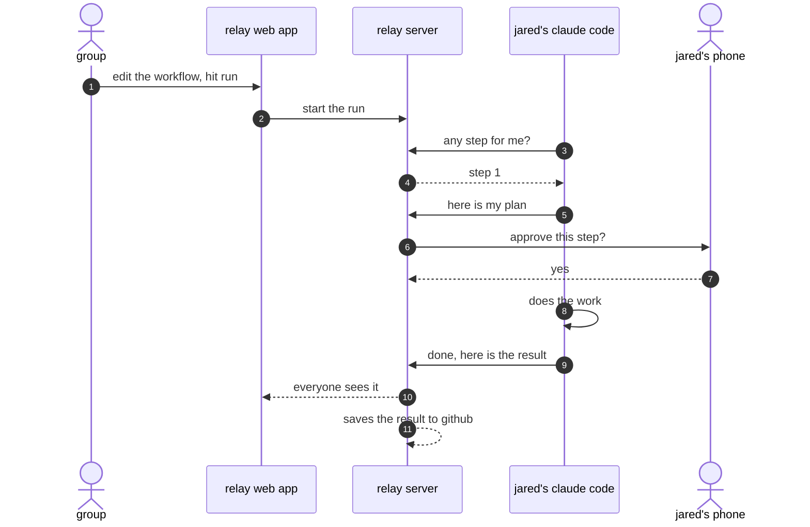
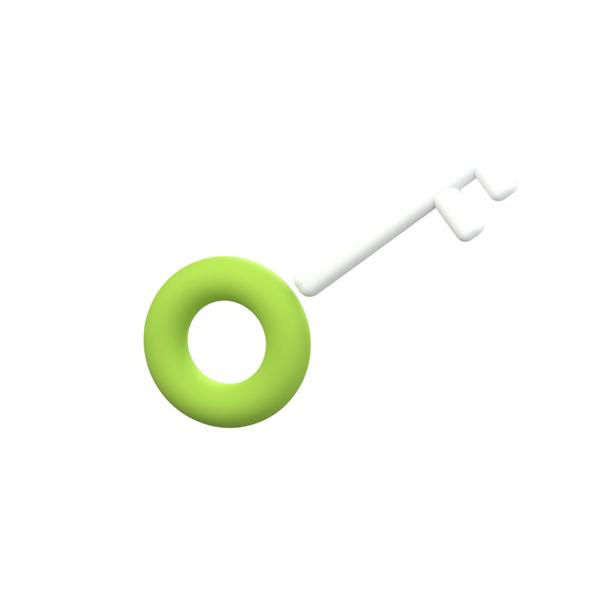
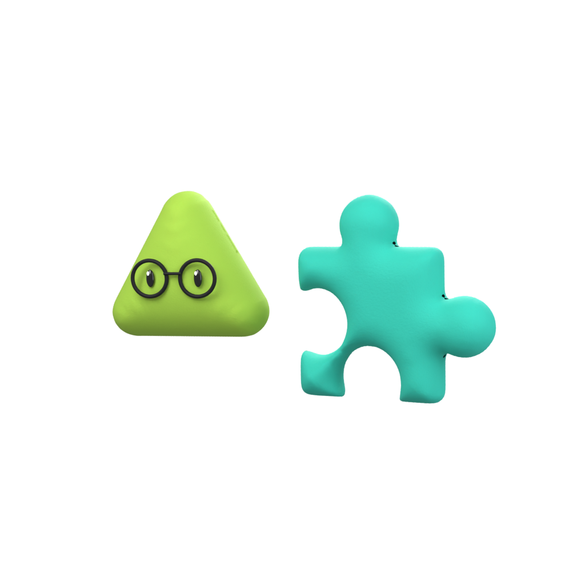
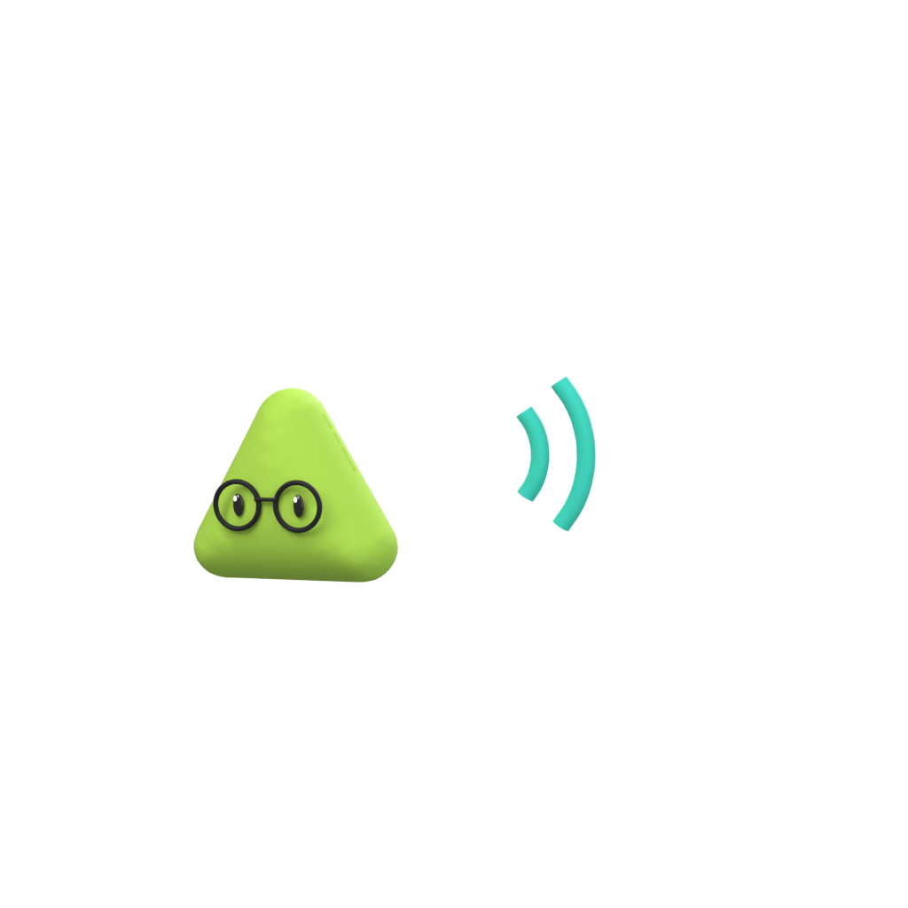
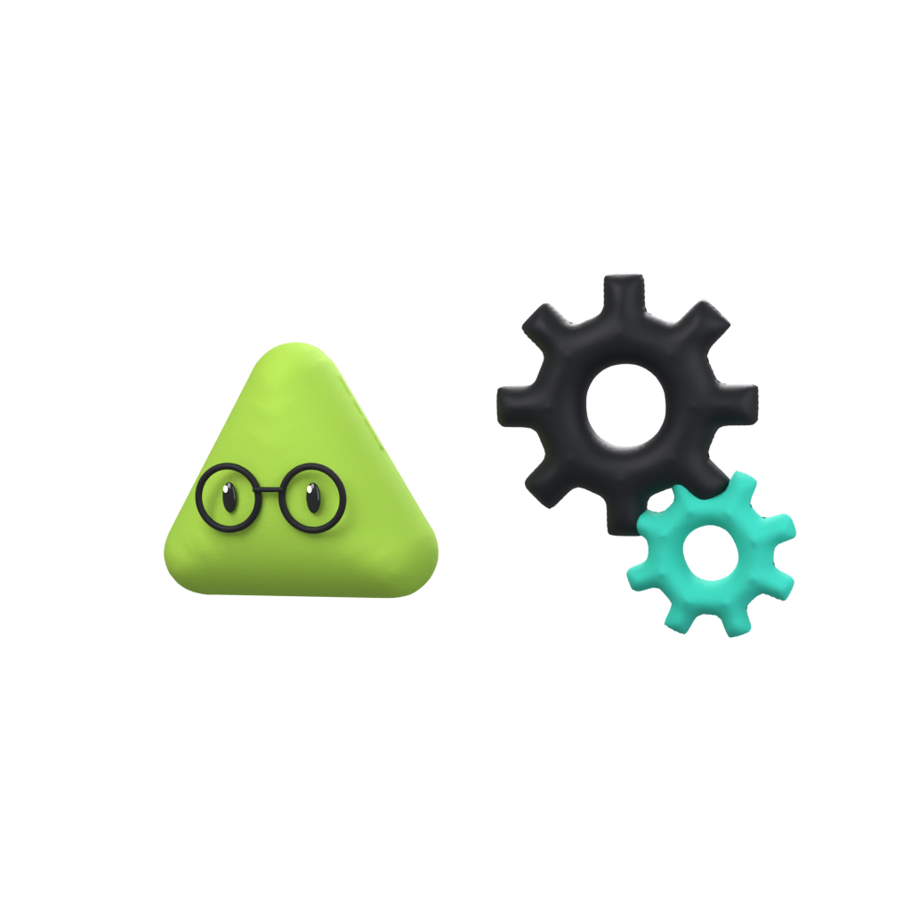
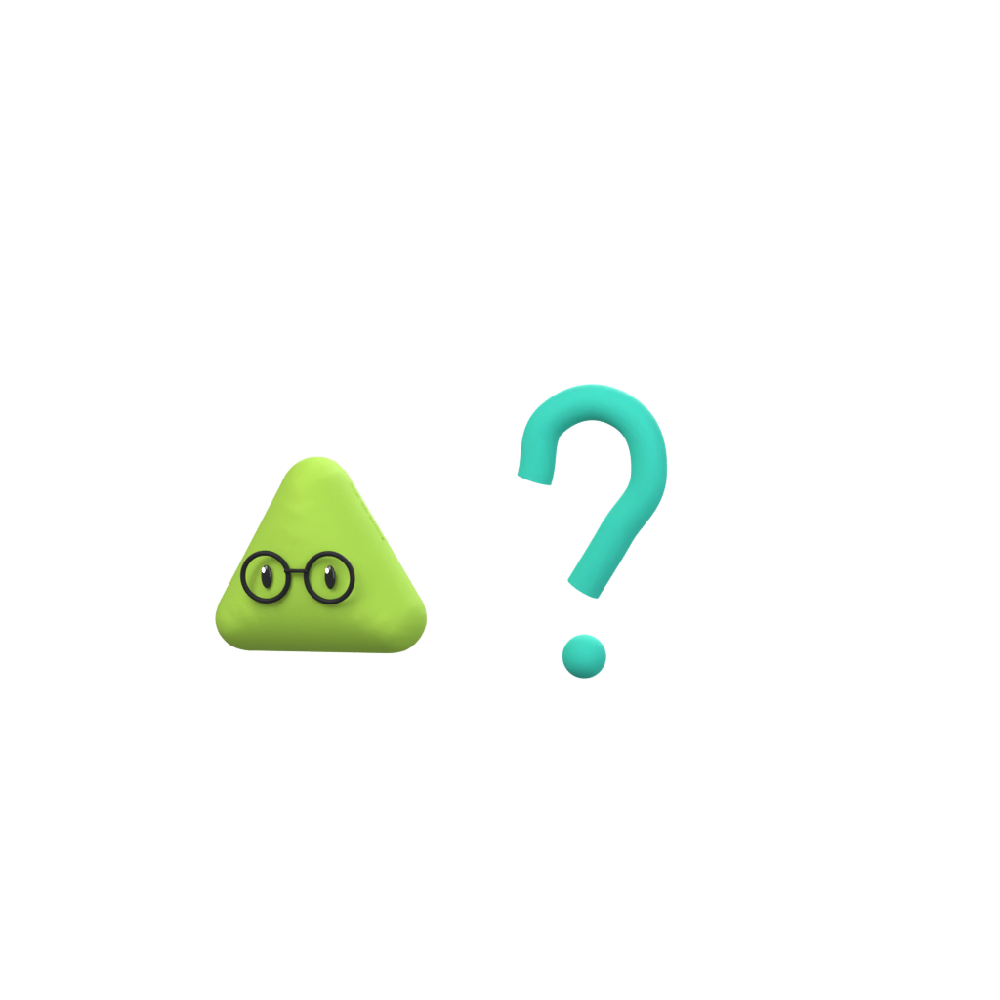
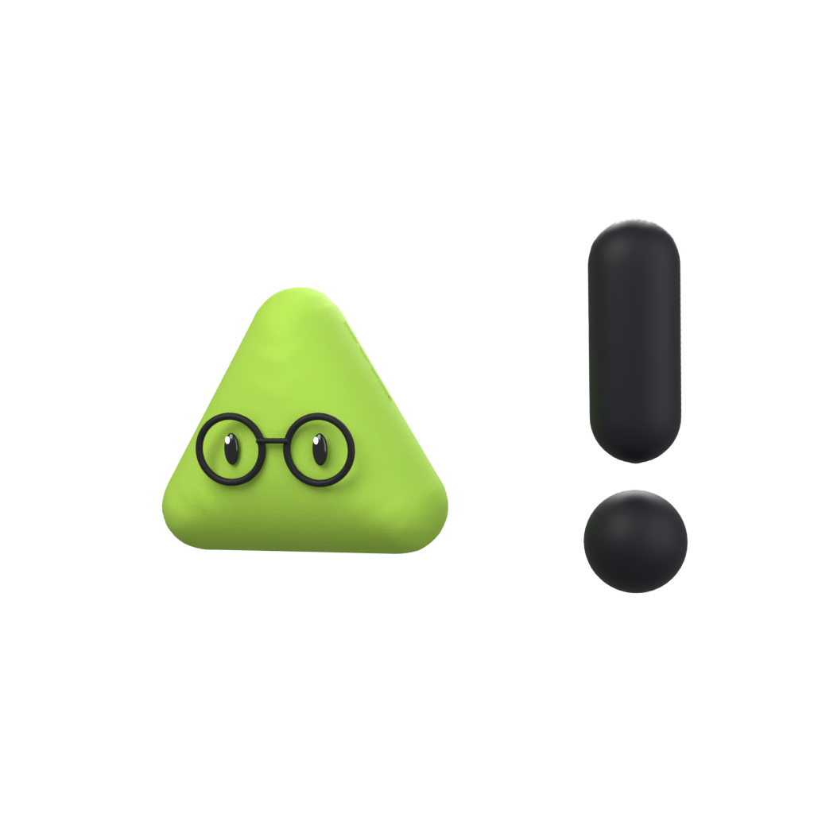

<p align="center">
  
</p>

<h1 align="center">relay</h1>

<p align="center">build a workflow with your group, live. each step runs on the right person's computer, on their own claude.</p>

---

relay is a shared to-do list for ai. your group writes it together in the browser. each step says whose computer does the work, and each person's own claude does it, one step after another.

> **status:** early. the plan is written and the first building blocks are being made. there is no app to download yet.

## what it does

- **build together.** everyone edits the same workflow at once and sees who is in which step.
- **run across computers.** each step goes to the computer you pick, one at a time, and passes its result along.
- **approve on your phone.** the computer's owner says yes before anything runs.
- **saved to github.** every workflow and every run is kept in your repo, so you have a history.
- **no ai bill from us.** your own claude does the work on your own plan.

## safe by default

computers are off until their owner switches them on. every step needs a yes. claude never types passwords. anyone can stop a run.

## more

- [the plan](plan/README.md): how it works, every screen, how it stays safe, the order to build
- [assets](assets/README.md): the mascot and icons

<<<<<<< HEAD
## watch it work

| | |
| --- | --- |
| **see every step live** | waiting, asking maya, running, done. the whole group sees the same thing. |
| **send a note** | "use the final branch." the running step gets it. |
| **stop any time** | anyone in the group can stop a run. |
| **stalled steps** | a step that goes quiet for 5 minutes shows up. retry it or skip it. |

## the workflow is a file

the group saves every workflow in its own github repo as a plain file. each finished run is saved next to it. you get a history of what you ran and how it went. other groups will be able to copy a workflow and make it theirs.

```
your-repo/
  workflows/
    demo-day/
      workflow.json
      runs/
        2026-11-16T21-30-05Z_r7k2p9.json
```

## where it runs

each person installs the relay plugin in their own claude code. their claude does the work on their own plan. relay's server never runs ai. it only passes the steps along.

| step needs | works on |
| --- | --- |
| **shell** (commands, files, code) | mac, windows or linux |
| **browser** | any computer where claude has a browser tool |
| **screen** (click and type in apps) | a mac with claude's computer use |



## safety

<table>
<tr>
<td align="center" width="25%">
<br>
<b>off by default</b><br>
<sub>your computer is off in every room until you switch it on.</sub>
</td>
<td align="center" width="25%">
<br>
<b>you approve every step</b><br>
<sub>you see the exact step and claude's plan first.</sub>
</td>
<td align="center" width="25%">
<br>
<b>never types passwords</b><br>
<sub>logins and codes stay with you. it pauses and asks.</sub>
</td>
<td align="center" width="25%">
<br>
<b>stop means stop</b><br>
<sub>any member can end a run. you can remove a device at any time.</sub>
</td>
</tr>
</table>

claude code's own permission prompts still appear on your computer. relay never asks you to skip them. relay's server has no ai key and makes no model calls. secrets are blocked from saved workflows and masked in saved results.

## who it's for

<table>
<tr>
<td width="55%">

### students and hackathon teams

> "pull the latest code on jared's mac, run the tests, record the demo, upload it."

everyone has different files and logins on their own laptop. relay lets one workflow use all of them.

</td>
<td width="45%" align="center">

</td>
</tr>
<tr>
<td>

### small startup teams

> "pull the numbers in ana's browser, draft the update in notion, ben approves, send."

each person keeps their own accounts. nobody shares a password.

</td>
<td align="center">

</td>
</tr>
</table>

## status

| piece | state |
| --- | --- |
| plan and task lists | written, in [`plan/`](plan/README.md) |
| project setup and automatic checks | built |
| workflow file format and checker | built, in `packages/format` |
| live editing engine (no screens) | built, in `packages/editor-core` |
| fake backend for building screens | built, in `packages/data` |
| live editing test kit | built, in `spikes/s3`. needs a run on real supabase |
| phone alert test kit | built, in `spikes/s5`. needs a run on a real iphone |
| screens (editor, run view, approvals) | waiting on the design system |
| database, plugin, github connection | next |

## read the plan

| doc | what it covers |
| --- | --- |
| [plan/README.md](plan/README.md) | start here |
| [01_product](plan/01_product.md) | who it's for, user stories, what's in the first version |
| [02_architecture](plan/02_architecture.md) | how the pieces fit |
| [03_workflow_format](plan/03_workflow_format.md) | the saved file |
| [04_plugin](plan/04_plugin.md) | the claude code plugin |
| [05_server](plan/05_server.md) | database and run engine |
| [06_web](plan/06_web.md) | every screen |
| [07_repo_sync](plan/07_repo_sync.md) | saving to github |
| [08_safety](plan/08_safety.md) | how it stays safe |
| [09_build_plan](plan/09_build_plan.md) | the order to build |
| [tasks/](plan/tasks/README.md) | who builds what |
| [research_summary](plan/research_summary.md) | what other products exist and why we picked these tools |

## assets

3d clay assets for the website: a mascot, icons for agents, devices, security and the interface. soft pillow clay, transparent backgrounds. white and black with menthe `#35C8B4`, brume `#C2F2E4`, limonade `#EDF7BE` and verveine `#A4CF4A`. the mascot is verveine.

each asset comes as `name.png` (512px) and `name@2x.png` (1024px). see [`assets/README.md`](assets/README.md) for the full list and how to rebuild them.

<p align="center">
  
</p>

## team

<table>
<tr>
<td align="center"><b>sweeya</b><br><sub>web app · live editing · format</sub></td>
<td align="center"><b>colby</b><br><sub>database · plugin · github</sub></td>
</tr>
</table>

<p align="center"><sub>a limontree project</sub></p>
=======
<p align="center"><sub>built by sweeya and colby · a limontree project</sub></p>
>>>>>>> origin/main
