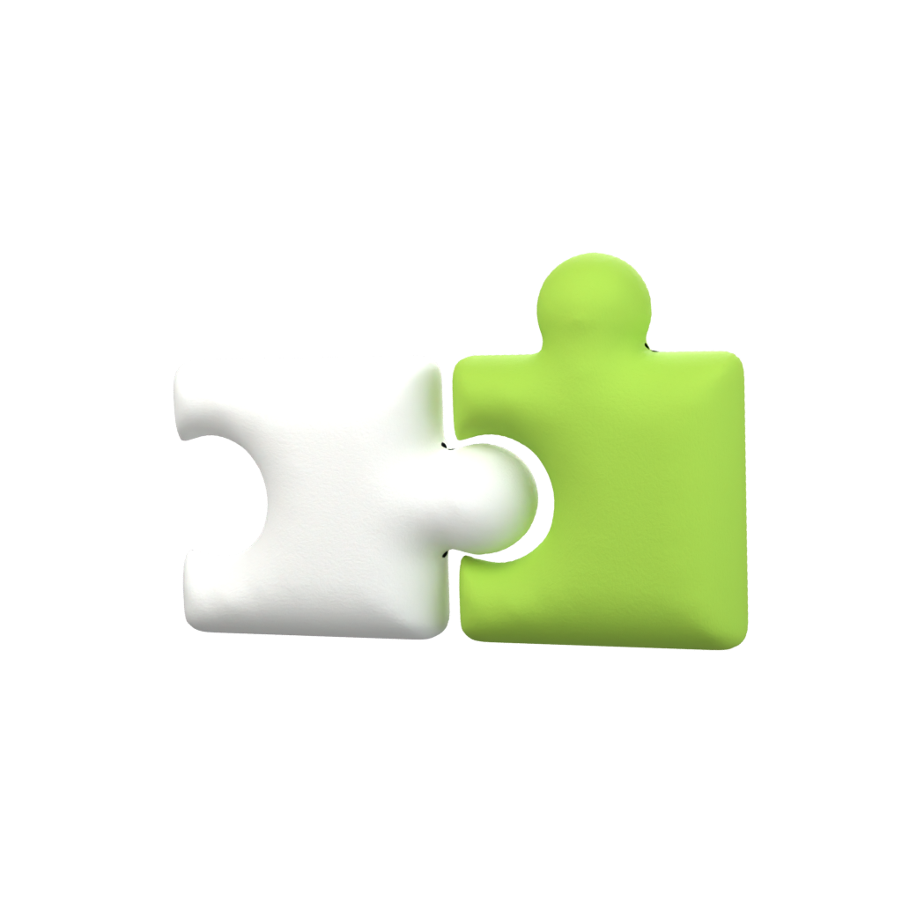
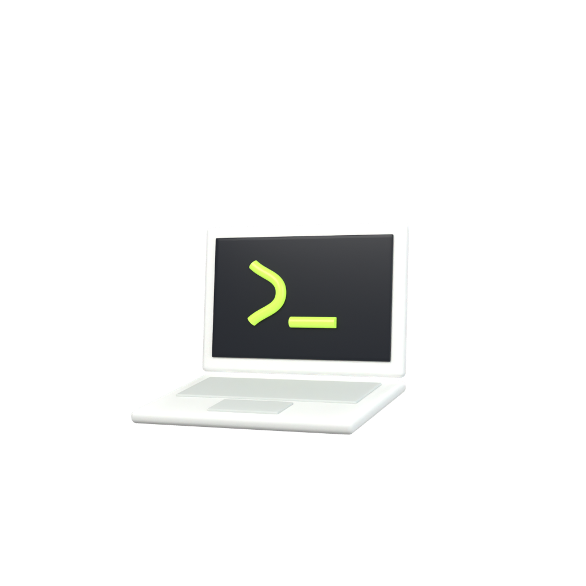
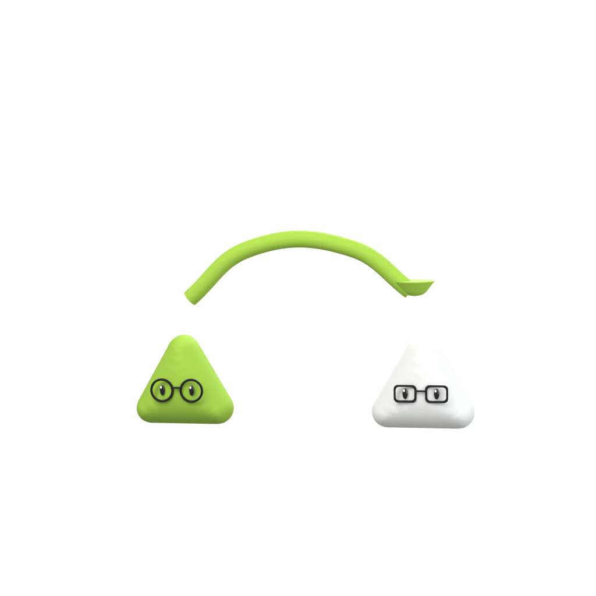
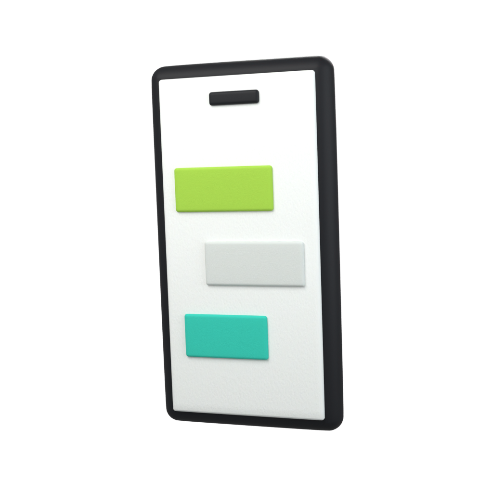
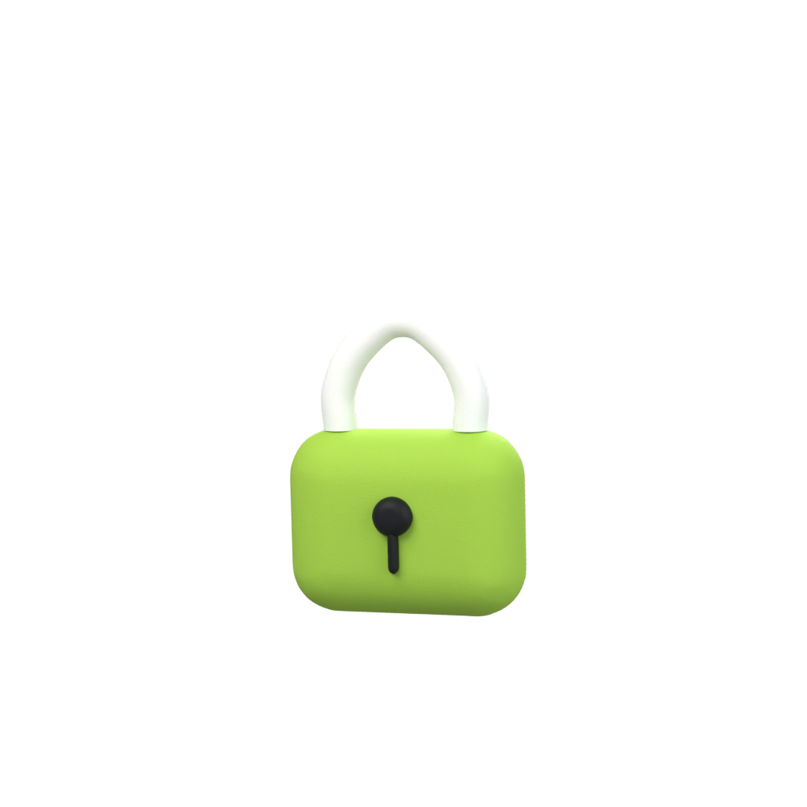
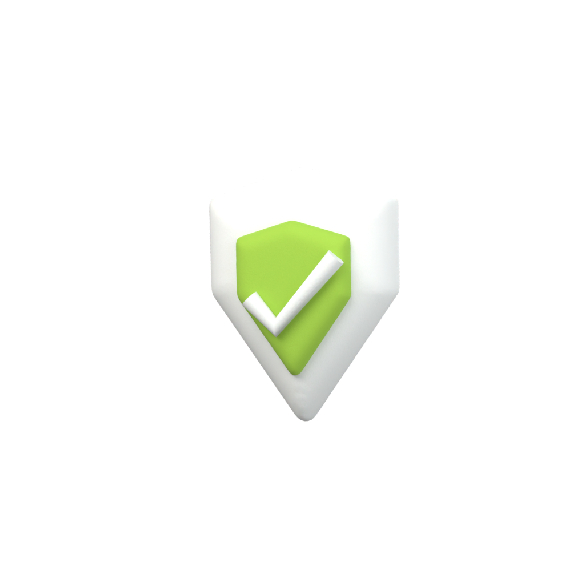
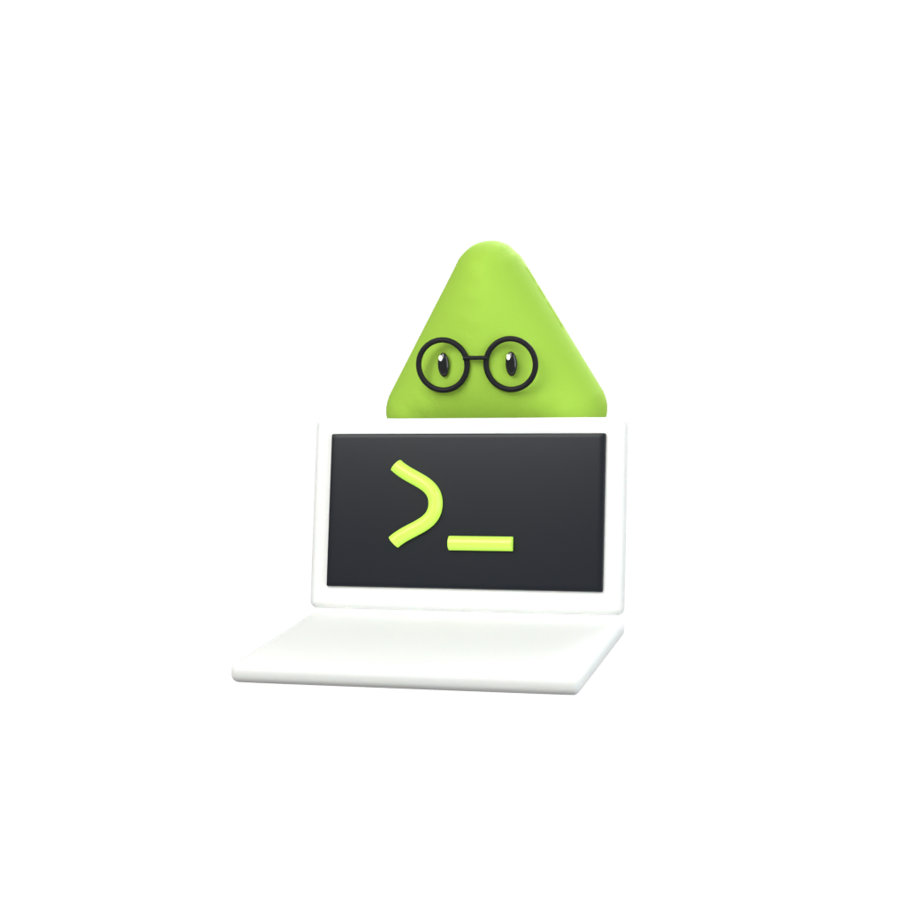
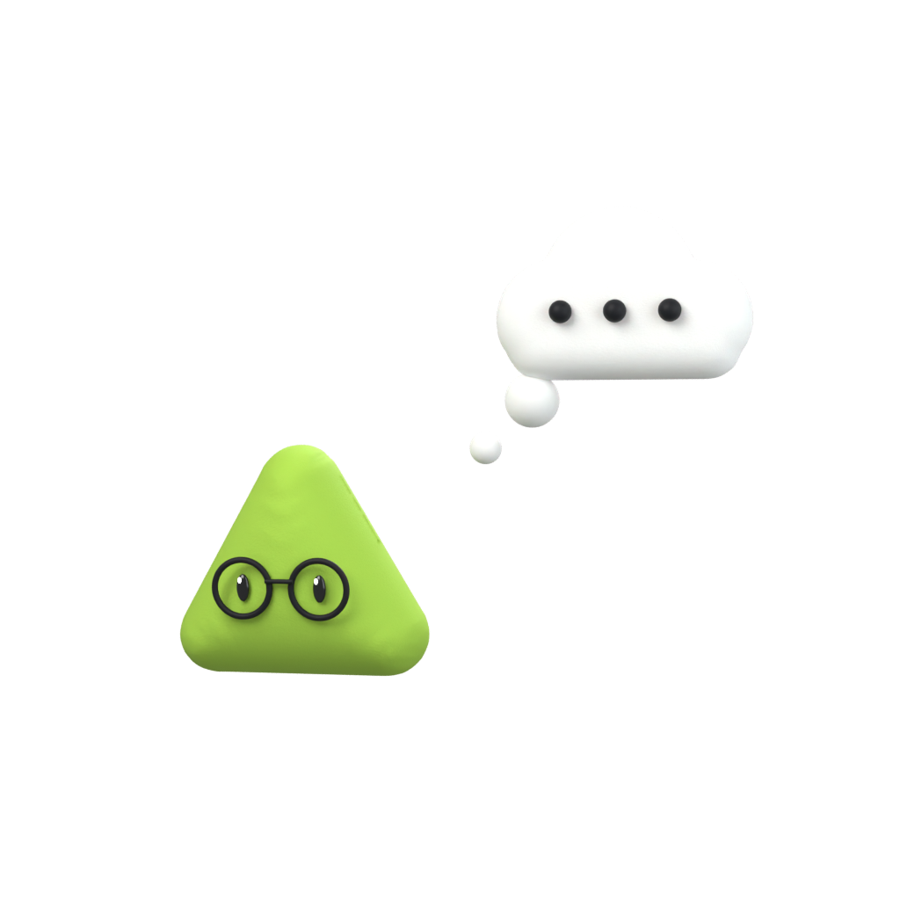
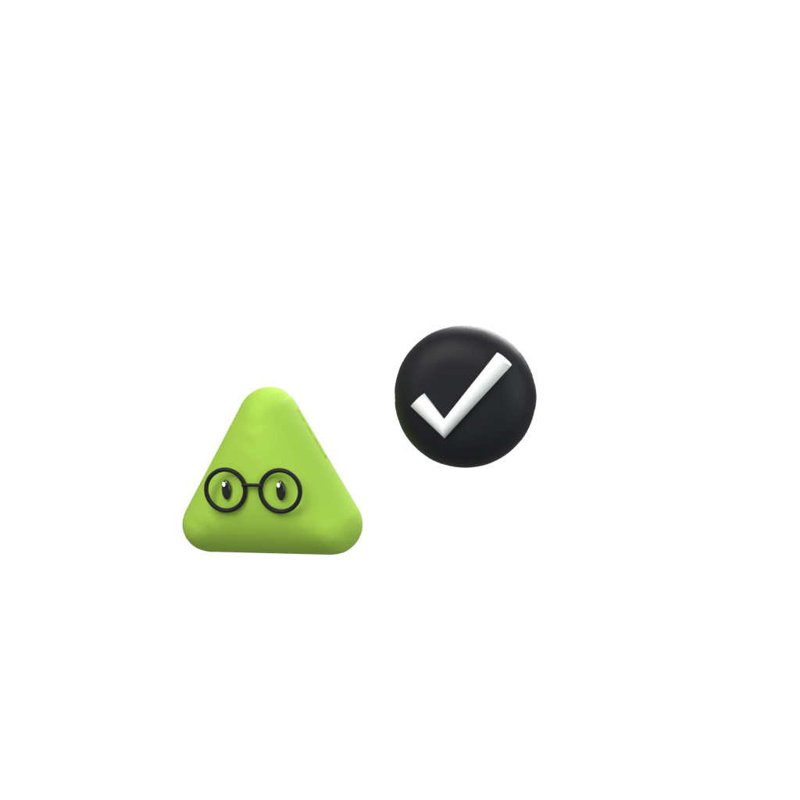

<p align="center">
  
</p>

<h1 align="center">relay</h1>

<p align="center">build a workflow with your group, live. each step runs on the right person's computer, on their own claude.</p>

---

## what is relay

relay is a shared to-do list for ai. your group writes it together in the browser, like a shared doc. each step says whose computer does the work. when you hit run, every step goes to that person's own claude, one after another, like passing a baton.

> **you:** pull the latest code, run the tests, record a 2 minute demo and upload it to devpost.
>
> **relay:** step 1 is on jared's mac. step 2 is on jared's mac. step 3 is on maya's laptop. everyone is watching. jared, step 1 is waiting for your yes.

no one gives their password to anyone. no one pays for anyone else's ai. nothing runs on your computer until you say yes.

> **status:** early. the plan is written and the first building blocks are being made. there is no app to try yet. see [status](#status).

## how it works

<table>
<tr>
<td align="center" width="25%">
<br>
<b>build together</b><br>
<sub>everyone edits the same list at once. you see who is in which step.</sub>
</td>
<td align="center" width="25%">
<br>
<b>pick a computer</b><br>
<sub>each step names whose computer runs it.</sub>
</td>
<td align="center" width="25%">
<br>
<b>run it</b><br>
<sub>steps go out one at a time. results pass to the next step.</sub>
</td>
<td align="center" width="25%">
<br>
<b>approve on your phone</b><br>
<sub>the computer's owner taps yes before each step.</sub>
</td>
</tr>
</table>

## watch it work

| | |
| --- | --- |
| **see every step live** | waiting, asking maya, running, done. the whole group sees the same thing. |
| **send a note** | "use the final branch." the running step gets it. |
| **stop any time** | anyone in the group can stop a run. |
| **stalled steps** | a step that goes quiet for 5 minutes shows up. retry it or skip it. |

## the workflow is a file

the group saves every workflow in its own github repo as a plain file. each finished run is saved next to it. you get a history of what you ran and how it went. other groups will be able to copy a workflow and make it theirs.

```
your-repo/
  workflows/
    demo-day/
      workflow.json
      runs/
        2026-11-16T21-30-05Z_r7k2p9.json
```

## where it runs

each person installs the relay plugin in their own claude code. their claude does the work on their own plan. relay's server never runs ai. it only passes the steps along.

| step needs | works on |
| --- | --- |
| **shell** (commands, files, code) | mac, windows or linux |
| **browser** | any computer where claude has a browser tool |
| **screen** (click and type in apps) | a mac with claude's computer use |

## safety

<table>
<tr>
<td align="center" width="25%">
<br>
<b>off by default</b><br>
<sub>your computer is off in every room until you switch it on.</sub>
</td>
<td align="center" width="25%">
<br>
<b>you approve every step</b><br>
<sub>you see the exact step and claude's plan first.</sub>
</td>
<td align="center" width="25%">
<br>
<b>never types passwords</b><br>
<sub>logins and codes stay with you. it pauses and asks.</sub>
</td>
<td align="center" width="25%">
<br>
<b>stop means stop</b><br>
<sub>any member can end a run. you can remove a device at any time.</sub>
</td>
</tr>
</table>

claude code's own permission prompts still appear on your computer. relay never asks you to skip them. relay's server has no ai key and makes no model calls. secrets are blocked from saved workflows and masked in saved results.

## who it's for

<table>
<tr>
<td width="55%">

### students and hackathon teams

> "pull the latest code on jared's mac, run the tests, record the demo, upload it."

everyone has different files and logins on their own laptop. relay lets one workflow use all of them.

</td>
<td width="45%" align="center">

</td>
</tr>
<tr>
<td>

### small startup teams

> "pull the numbers in ana's browser, draft the update in notion, ben approves, send."

each person keeps their own accounts. nobody shares a password.

</td>
<td align="center">

</td>
</tr>
</table>

## status

| piece | state |
| --- | --- |
| plan and task lists | written, in [`plan/`](plan/README.md) |
| workflow file format and checker | built, not merged |
| live editing engine (no screens) | built, not merged |
| fake backend for building screens | built, not merged |
| live editing test kit | built. needs a run on real supabase |
| phone alert test kit | built. needs a run on a real iphone |
| screens (editor, run view, approvals) | waiting on the design system |
| database, plugin, github connection | next |

## read the plan

| doc | what it covers |
| --- | --- |
| [plan/README.md](plan/README.md) | start here |
| [01_product](plan/01_product.md) | who it's for, user stories, what's in the first version |
| [02_architecture](plan/02_architecture.md) | how the pieces fit |
| [03_workflow_format](plan/03_workflow_format.md) | the saved file |
| [04_plugin](plan/04_plugin.md) | the claude code plugin |
| [05_server](plan/05_server.md) | database and run engine |
| [06_web](plan/06_web.md) | every screen |
| [07_repo_sync](plan/07_repo_sync.md) | saving to github |
| [08_safety](plan/08_safety.md) | how it stays safe |
| [09_build_plan](plan/09_build_plan.md) | the order to build |
| [tasks/](plan/tasks/README.md) | who builds what |
| [research_summary](plan/research_summary.md) | what other products exist and why we picked these tools |

## assets

3d clay assets for the website: a mascot, icons for agents, devices, security and the interface. soft pillow clay, transparent backgrounds. white and black with menthe `#35C8B4`, brume `#C2F2E4`, limonade `#EDF7BE` and verveine `#A4CF4A`. the mascot is verveine.

each asset comes as `name.png` (512px) and `name@2x.png` (1024px). see [`assets/README.md`](assets/README.md) for the full list and how to rebuild them.

<p align="center">
  
</p>

## team

<table>
<tr>
<td align="center"><b>sweeya</b><br><sub>web app · live editing · format</sub></td>
<td align="center"><b>colby</b><br><sub>database · plugin · github</sub></td>
</tr>
</table>

<p align="center"><sub>a limontree project</sub></p>
